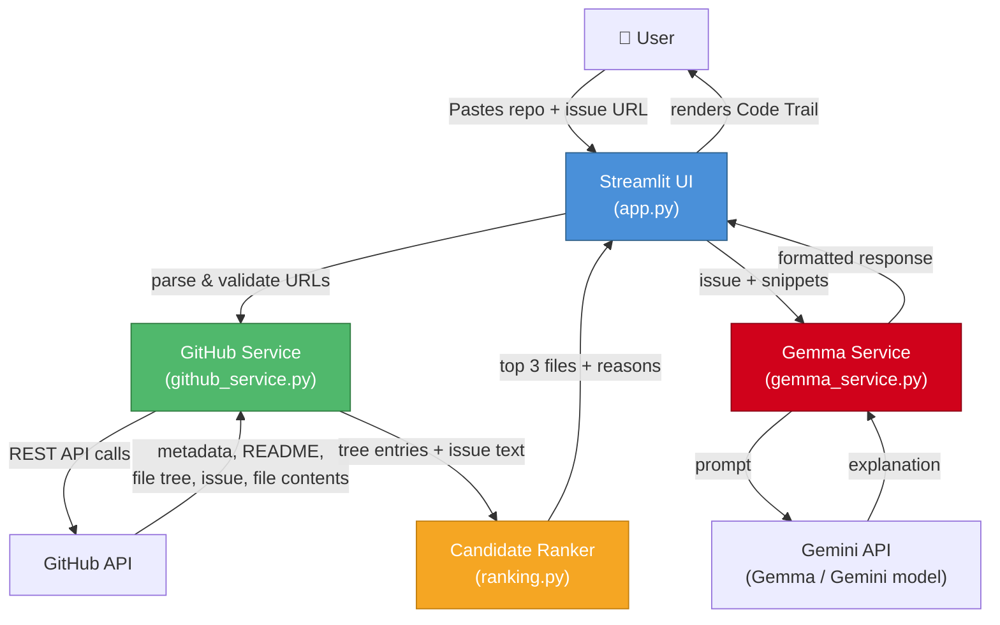

# RepoRescue (Digital Archaeologist) — Architecture, Analysis & MVP Plan

> **Context**: 4 teammates, fast-track MVP plan starting from an empty repo. This document serves as the core operational reference for developers and AI agents.

---

## 1. What is RepoRescue / Digital Archaeologist?

A **Streamlit web application** that acts as an automated triage tool and code trail navigator for open-source contributors and developers investigating a GitHub issue. 

You provide a **GitHub Repository URL** and an **Issue URL** → the tool:
1. Fetches repository metadata and git tree entries via GitHub REST API.
2. Extracts keywords and deterministically ranks the top candidate source files likely responsible for or relevant to the issue.
3. Retrieves real file contents/snippets (truncated safely to fit context windows).
4. Sends the evidence and issue context to **Google Gemini / Gemma** using the `google-genai` SDK.
5. Displays a rich, visual **"Code Trail"** with direct GitHub links, ranking rationales, grounded AI explanations, and concrete next-step investigation recommendations.

**Key Architectural Principle**: Deterministic, verifiable code analysis first; AI strictly for synthesis, explanation, and guided investigation. No hallucinated files, no imaginary line numbers.

---

## 2. Architecture Overview



### Module Responsibilities

| Module | Responsibility | Depends On |
|--------|---------------|------------|
| `app.py` | UI layout, user inputs, reactive state, button handlers, rendering results | `github_service`, `ranking`, `gemma_service`, `streamlit` |
| `github_service.py` | URL parsing, GitHub REST API calls, git tree & content fetching, error handling | `requests` library |
| `ranking.py` | Keyword extraction, tokenization, file path scoring, candidate selection & rationale | Pure Python (`re`, standard library) |
| `gemma_service.py` | Prompt construction, Gemini / Gemma API invocation via `google-genai`, response formatting | `google-genai` SDK |

### Data Flow (Step by Step)

```text
1. User enters repo URL  → parse_repo_url("https://github.com/owner/repo")
                             → returns ("owner", "repo")

2. Fetch repo overview  → get_repository_overview("owner", "repo")
                             → returns {name, description, language, default_branch, tree_entries[]}

3. User enters issue URL → parse_issue_url("https://github.com/owner/repo/issues/42", "owner", "repo")
                             → returns 42

4. Fetch issue          → get_issue("owner", "repo", 42)
                             → returns {title, body, url, number}

5. Rank files           → rank_candidate_files(issue_title + issue_body, tree_entries)
                             → returns [{path, score, reason}, ...] (max 3)

6. Fetch file contents  → get_file_text("owner", "repo", "src/auth.py", "main") × up to 3
                             → returns truncated source code string

7. Call Gemma / Gemini  → analyze_issue_with_gemma(repo_info, issue, candidates_with_snippets)
                             → returns markdown explanation string

8. Render Code Trail    → Streamlit UI renders visual cards, diff-like snippets, and action checklist
```

---

## 3. Function Contracts & Interfaces

### `github_service.py`
```python
def parse_repo_url(repo_url: str) -> tuple[str, str]:
    """Parse 'https://github.com/owner/repo' into ('owner', 'repo'). Raises ValueError if invalid."""

def parse_issue_url(issue_url: str, expected_owner: str, expected_repo: str) -> int:
    """Parse issue number from URL matching expected repository. Raises ValueError if invalid."""

def get_repository_overview(owner: str, repo: str) -> dict:
    """Fetch repo metadata and recursive git tree entries.
    Returns: {
        'name': str,
        'description': str | None,
        'language': str | None,
        'default_branch': str,
        'tree_entries': list[dict]
    }
    """

def get_issue(owner: str, repo: str, issue_number: int) -> dict:
    """Fetch issue title, markdown body, html_url, and number."""

def get_file_text(owner: str, repo: str, path: str, ref: str) -> str:
    """Fetch raw file content decoded as UTF-8, truncated to ~6000 chars."""
```

### `ranking.py`
```python
def rank_candidate_files(issue_text: str, tree_entries: list[dict], limit: int = 3) -> list[dict]:
    """Score file paths against keywords extracted from the issue title and body.
    Returns: [
        {
            'path': 'src/auth/login.py',
            'score': int,
            'reason': 'Path contains terms matching issue: auth, login'
        }, ...
    ]
    """
```

### `gemma_service.py`
```python
def analyze_issue_with_gemma(repo_info: dict, issue: dict, candidates: list[dict]) -> str:
    """Send structured prompt to Gemini / Gemma with factual repository context, issue text,
    and actual file snippets. Returns grounded Markdown analysis."""
```

---

## 4. Tech Stack Quick Reference

| Component | Library / Technology | Purpose |
|-----------|----------------------|---------|
| Frontend | `streamlit` | Clean, interactive web UI with cards and spinners |
| HTTP Client | `requests` | GitHub REST v3 API interaction |
| AI / LLM | `google-genai` | Gemma / Gemini multimodal API client |
| Configuration | `python-dotenv` | Loads environment variables from `.env` |
| Runtime | Python 3.10+ | Core language environment |

---

## 5. Post-MVP Extension: Codebase Knowledge Graph Generator

> [!NOTE]
> **Priority & Scope**: The core feature and primary mission of Digital Archaeologist is **codebase summarization and issue triage** (producing the Code Trail). This Knowledge Graph extension is scheduled strictly **post-MVP**, and will only be implemented once the MVP is verified, stable, and working.

### Purpose
When downstream AI agents (like coding assistants or automated agents) work on a repository, injecting full source files into context consumes tens of thousands of tokens and causes context rot. By generating a compact, structural **Knowledge Graph** output alongside the codebase summary:
- Downstream AI agents ingest a dense, token-efficient structural map (nodes = files/modules/classes, edges = imports/dependencies).
- AI agents get full architectural context while consuming dramatically fewer tokens.

### Planned Output Specification
- **Format**: JSON artifact (`knowledge_graph.json`) and visual graph (Mermaid / SVG).
- **Graph Schema**:
  ```json
  {
    "repository": "owner/repo",
    "summary": "Core architectural summary of the codebase...",
    "nodes": [
      {"id": "src/auth.py", "type": "module", "exports": ["login", "verify_token"]},
      {"id": "src/db.py", "type": "module", "exports": ["get_db_session"]}
    ],
    "edges": [
      {"source": "src/auth.py", "target": "src/db.py", "relation": "imports"}
    ]
  }
  ```
- **Execution Condition**: Strictly gated behind MVP validation and flag toggle (`ENABLE_KNOWLEDGE_GRAPH=false` by default).