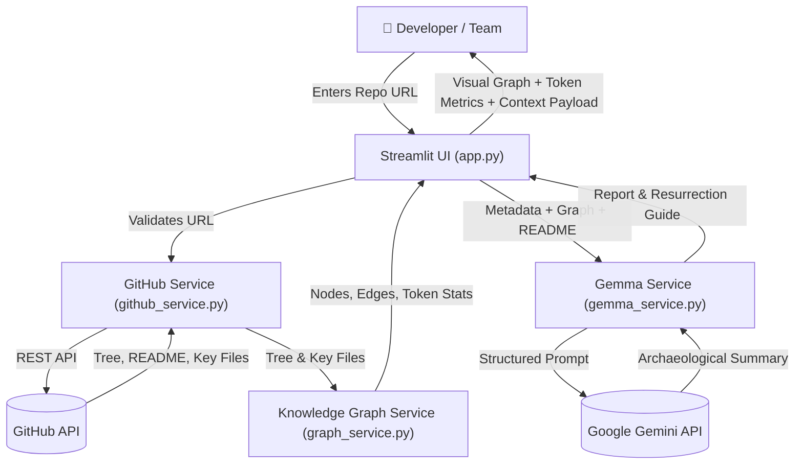

# Digital Archaeologist — Architecture, Analysis & Core MVP Plan

> **Core Mission**: Help developers and teams who have abandoned, dormant, or inherited projects quickly re-understand their codebase. When handing off the project to an LLM or AI coding agent, Digital Archaeologist constructs a **Codebase Knowledge Graph** that delivers full architectural awareness while consuming up to **90%+ fewer tokens** than dumping raw source files.

---

## 1. What is Digital Archaeologist?

An automated **codebase excavation and structural knowledge graph engine** built with Streamlit.

When you return to an old side project or inherit an unfamiliar repository, you don't know where execution starts, how modules connect, or what the architecture looks like. Furthermore, if you paste hundreds of files into an AI assistant, you burn tens of thousands of tokens, hit rate limits, and suffer from "lost-in-the-middle" context rot.

Digital Archaeologist solves both problems:
1. **Repository Excavation**: Fetches repository structure, README, dependency manifests, and key entry points via GitHub REST API.
2. **Knowledge Graph Generation**: Deterministically maps files, modules, classes/functions, and dependency/import relationships into a connected node-and-edge graph (`knowledge_graph.json` and visual Mermaid topology).
3. **Token Economics Optimization**: Compares raw codebase token size against the compact Knowledge Graph, providing 85%–95% token savings for downstream LLM prompts.
4. **Architectural Synthesis (Gemini / Gemma)**: Uses Google GenAI to synthesize an Executive Codebase Summary, Module Breakdown, Entry Point Flow, and a Project Resurrection Guide.
5. **AI Agent Context Exporter**: Outputs a ready-to-use prompt payload for external AI agents (Cursor, Devin, Windsurf, Claude, ChatGPT).

---

## 2. Architecture Overview



### Module Responsibilities

| Module | Responsibility | Depends On |
|--------|---------------|------------|
| `app.py` | Streamlit web interface, excavation pipeline, tabs, token stats, exports | All modules |
| `github_service.py` | Repository overview, recursive tree, README, key file retrieval | `requests` |
| `graph_service.py` | AST/regex parsing of imports/symbols, node/edge creation, Mermaid generation, token economics | Pure Python (`re`, standard library) |
| `gemma_service.py` | Gemini/Gemma prompt construction, architectural synthesis, resurrection guide | `google-genai` SDK |

---

## 3. Function Contracts & Interfaces

### `github_service.py`
```python
def parse_repo_url(repo_url: str) -> tuple[str, str]:
    """Parse 'https://github.com/owner/repo' into ('owner', 'repo'). Raises ValueError if invalid."""

def get_repository_overview(owner: str, repo: str, token: str | None = None) -> dict:
    """Fetch repo metadata and recursive git tree entries."""

def get_readme(owner: str, repo: str, default_branch: str = "main", token: str | None = None) -> str:
    """Fetch repository README content if available."""

def get_key_source_files(owner: str, repo: str, tree_entries: list[dict], default_branch: str = "main", max_files: int = 15, token: str | None = None) -> dict[str, str]:
    """Fetch the contents of the most important entry points, manifests, and core files."""
```

### `graph_service.py`
```python
def build_knowledge_graph(repo_name: str, tree_entries: list[dict], file_contents: dict[str, str]) -> dict:
    """Constructs nodes, edges, Mermaid diagram, and token economics for downstream AI agents."""
```

### `gemma_service.py`
```python
def generate_archaeology_summary(repo_info: dict, readme_text: str, graph_data: dict, api_key: str | None = None, model: str | None = None) -> str:
    """Sends structured prompt to Gemini/Gemma to produce an executive codebase report and AI context."""
```

---

## 4. Tech Stack Quick Reference

| Component | Library / Technology | Purpose |
|-----------|----------------------|---------|
| Frontend | `streamlit` | Clean, interactive web UI with token metrics and Mermaid graphs |
| HTTP Client | `requests` | GitHub REST v3 API interaction |
| AI / LLM | `google-genai` (Gemma Track) | Gemma 4 (`gemma-4-26b-a4b-it`) architectural synthesis |
| Graphing | `Mermaid.js` (native Markdown) | Visual module topology diagram |
| Secrets | `python-dotenv` | Loads environment variables from `.env` |
| Runtime | Python 3.10+ | Core language environment |

---

## 5. Harnessing Gemma in a Smart Way (Hackathon Track)

Instead of naively prompting Gemma with massive, raw source files (which wastes tokens and causes context rot), Digital Archaeologist uses a **Two-Tier Intelligence Architecture**:

1. **Tier 1 (Deterministic Knowledge Graph Compression)**:
   - Python scans the full repository tree, extracts imports/exports, filters noise, and maps modules into a compact node-edge topological model (`graph_service.py`).
   - Cuts raw context volume by **85%–95%** *before* touching the model.

2. **Tier 2 (Gemma Semantic Synthesis)**:
   - Gemma receives the pre-compressed Knowledge Graph + README + key entry point signatures.
   - Operated at **temperature 0.2** for grounded, factual systems architecture reasoning.
   - Resilient multi-model fallback across the Gemma family (`gemma-4-26b-a4b-it` → `gemma-4-31b-it` → `gemma-3-27b-it`).