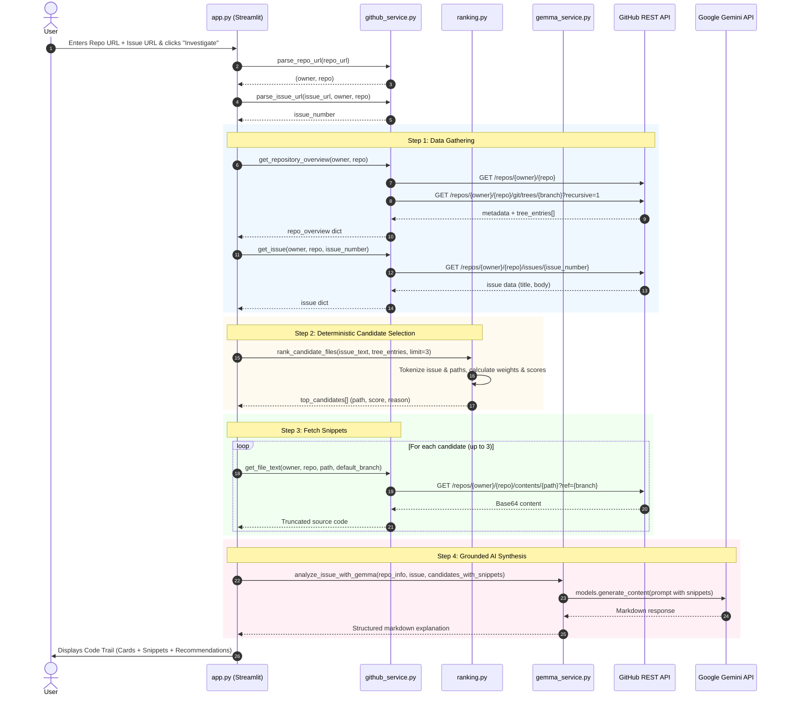
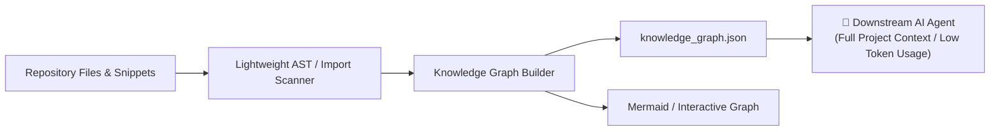

# 📋 Digital Archaeologist (RepoRescue) — Implementation Plan

> **Objective**: Build and deliver a functional, resilient, and beginner-friendly Streamlit web application that accepts a GitHub repository and issue URL, deterministically identifies relevant source files, and leverages Google Gemini / Gemma to synthesize an evidence-grounded investigation "Code Trail".

---

## 📑 Table of Contents

1. [Architectural Principles & Non-Goals](#1-architectural-principles--non-goals)
2. [End-to-End Process Breakdown](#2-end-to-end-process-breakdown)
   - [Process 1: Environment & Project Setup](#process-1-environment--project-setup)
   - [Process 2: GitHub Data Service (`github_service.py`)](#process-2-github-data-service-github_servicepy)
   - [Process 3: Deterministic Candidate Ranking (`ranking.py`)](#process-3-deterministic-candidate-ranking-rankingpy)
   - [Process 4: Gemma / Gemini AI Reasoning (`gemma_service.py`)](#process-4-gemma--gemini-ai-reasoning-gemma_servicepy)
   - [Process 5: Interactive Web UI (`app.py`)](#process-5-interactive-web-ui-apppy)
   - [Process 6: Testing, Edge Cases & Verification](#process-6-testing-edge-cases--verification)
3. [Interface Contracts & Data Specifications](#3-interface-contracts--data-specifications)
4. [Step-by-Step Execution Milestones](#4-step-by-step-execution-milestones)
5. [Risk Matrix & Fallback Strategies](#5-risk-matrix--fallback-strategies)

---

## 1. Architectural Principles & Non-Goals

### Guiding Principles
- **Evidence-First / Anti-Hallucination**: The LLM is never permitted to guess which files exist in the repository. Python code queries the GitHub API and extracts actual files and snippets; the LLM's role is strictly confined to interpreting the provided evidence.
- **Deterministic Ranking**: Finding candidate files relies on transparent, verifiable keyword overlap rather than black-box embeddings or ungrounded model queries.
- **Fail Gracefully**: If the GitHub API hits rate limits or if the Gemini API key is missing, the application must display clear, actionable notices rather than crashing.

### Non-Goals for the MVP
- Building a multi-turn chat assistant.
- Automated code fixing or generating pull requests.
- Full AST dependency graph parsing across multiple languages.

---

## 2. End-to-End Process Breakdown



---

### Process 1: Environment & Project Setup

1. **Virtual Environment**: Isolate dependencies with `venv` (`python -m venv venv`).
2. **Dependencies**:
   - `streamlit`: Web presentation framework.
   - `requests`: HTTP calls with connection timeouts.
   - `google-genai`: Official Google client for Gemini and Gemma models.
   - `python-dotenv`: Environment configuration loader.
3. **Configuration**:
   - `.env` storing `GEMINI_API_KEY`, `GEMMA_MODEL` (default: `gemini-2.5-flash`), and optional `GITHUB_TOKEN`.
   - `.gitignore` safeguarding secrets and cache directories.

---

### Process 2: GitHub Data Service (`github_service.py`)

Responsible for all communication with GitHub REST v3 API:

1. **URL Parsing & Validation**:
   - `parse_repo_url(url)`: Validates domain (`github.com`) and extracts `owner` and `repo`. Handles trailing slashes and `.git` suffixes.
   - `parse_issue_url(url, expected_owner, expected_repo)`: Validates that the issue belongs to the target repo and extracts the integer issue number.
2. **Repository Metadata**:
   - Fetches repository name, description, primary language, and `default_branch` via `GET /repos/{owner}/{repo}`.
3. **Recursive Git Tree**:
   - Fetches the repository tree structure in a single request via `GET /repos/{owner}/{repo}/git/trees/{default_branch}?recursive=1`.
   - Filters entries to only retain files (`type == "blob"`).
4. **Issue Fetching**:
   - Retrieves `title`, `body`, and `html_url` via `GET /repos/{owner}/{repo}/issues/{issue_number}`.
5. **Raw Content Retrieval**:
   - Uses `GET /repos/{owner}/{repo}/contents/{path}?ref={ref}` with header `Accept: application/vnd.github.v3+json`.
   - Decodes Base64 content to UTF-8 (ignoring binary/decoding errors).
   - Truncates to ~6,000 characters to prevent overflowing LLM context limits while retaining critical headers, imports, and top-level logic.

---

### Process 3: Deterministic Candidate Ranking (`ranking.py`)

Scores repository files based on textual evidence without AI latency or expense:

1. **Stopword Elimination**:
   - Strips generic programming words (e.g., `the`, `is`, `error`, `bug`, `issue`, `def`, `return`, `class`, `function`).
2. **Keyword Tokenization**:
   - Deconstructs issue title and issue body into normalized alphanumeric tokens.
   - Gives 3x weight to words appearing in the issue title vs the issue body.
   - Splits camelCase, snake_case, and kebab-case tokens in file paths (e.g., `user_profile.py` → `user`, `profile`).
3. **Path Filtering**:
   - Excludes non-source files (`.png`, `.jpg`, `.svg`, `.lock`, `.min.js`, `.csv`, `.md`, `.git*`).
   - Prioritizes core source code files (`.py`, `.js`, `.ts`, `.go`, `.java`, `.rs`, `.cpp`, `.c`).
4. **Scoring Formula**:
   - Exact file name match = +10 points.
   - Path segment match = +3 points per term.
   - Title keyword match in path = +5 points.
5. **Rationale Generation**:
   - Formulates a human-readable explanation string for why the file was selected (e.g., *"Matches title terms 'auth' and 'session', located in core authentication module"*).
6. **Selection**:
   - Sorts descending by score and returns top 3 candidate records.

---

### Process 4: Gemma / Gemini AI Reasoning (`gemma_service.py`)

Generates the beginner-friendly Code Trail triage guide:

1. **Client Setup**:
   - Initializes `genai.Client(api_key=...)` using `google-genai`.
2. **Prompt Construction**:
   - Injects repository context (`name`, `description`, `language`).
   - Injects the exact `issue.title` and `issue.body`.
   - Injects candidate file paths, ranking scores, and the actual extracted code snippets.
3. **Strict Grounding Directives**:
   - Mandates that the model:
     - Summarizes the problem in 2 clear sentences.
     - Details what the provided snippets actually show (factual observations only).
     - Explains why each candidate file relates to the issue.
     - Outlines 3–5 concrete next steps (e.g., files to inspect, tests to run, break-points to set).
     - Explicitly lists what *cannot* be determined from the snippet alone.
     - **Forbidden**: Inventing files, fabricating line numbers, or declaring bugs fixed.
4. **Error Resilience**:
   - Captures quota errors, network timeouts, or invalid API keys. Returns a clean fallback message allowing the UI to present the ranked files even if the AI service is unavailable.

---

### Process 5: Interactive Web UI (`app.py`)

A reactive Streamlit interface providing real-time feedback:

1. **Header & Context**:
   - Title, subtitle, and brief usage instructions.
2. **Inputs**:
   - `st.text_input` for Repository URL (with quick-fill examples).
   - `st.text_input` for Issue URL.
   - Primary `st.button` ("🔎 Investigate Issue").
3. **Processing Feedback**:
   - Uses `st.status` or `st.spinner` with live progress updates:
     - *"Fetching repository overview and tree..."*
     - *"Analyzing issue keywords and ranking files..."*
     - *"Retrieving candidate source code..."*
     - *"Synthesizing Code Trail with Gemini..."*
4. **Code Trail Presentation**:
   - **Repository Banner**: Shows repo name, description, primary language, and default branch badge.
   - **Candidate File Cards**:
     - Metric badge (Score & Matches).
     - Clickable link directly to the file on GitHub.
     - Expandable code viewer (`st.code`) displaying the fetched snippet.
     - Human-readable selection reason.
   - **AI Analysis & Action Plan**:
     - Formatted Markdown rendering the 5-point triage response.
5. **Error Notifications**:
   - Displays friendly `st.error` messages for bad URLs, missing issues, or API rate limit warnings.

---

### Process 6: Testing, Edge Cases & Verification

1. **URL Robustness**:
   - Handles trailing slashes, `.git` suffixes, and varied casing.
   - Rejects non-GitHub URLs gracefully.
2. **Rate Limit Handling**:
   - Unauthenticated GitHub API allows 60 requests/hr.
   - Single run requires: 1 (repo) + 1 (tree) + 1 (issue) + 3 (contents) = 6 calls.
   - Provides notice to add `GITHUB_TOKEN` to `.env` if 403 Forbidden is returned.
3. **Edge Repositories**:
   - Handles repositories with no files matching the issue (returns helpful fallback message).
   - Handles repositories with large trees (filters to blobs immediately).

---

## 3. Interface Contracts & Data Specifications

### `github_service.py`
```python
def parse_repo_url(repo_url: str) -> tuple[str, str]:
    """Extract (owner, repo) from GitHub URL.
    Example: 'https://github.com/psf/requests/' -> ('psf', 'requests')
    """

def parse_issue_url(issue_url: str, expected_owner: str, expected_repo: str) -> int:
    """Extract issue number from URL and verify owner/repo match.
    Example: 'https://github.com/psf/requests/issues/42' -> 42
    """

def get_repository_overview(owner: str, repo: str, token: str | None = None) -> dict:
    """Fetch repo info and git tree.
    Returns: {
        'name': str,
        'description': str | None,
        'language': str | None,
        'default_branch': str,
        'tree_entries': list[dict]  # list of {'path': str, 'type': str}
    }
    """

def get_issue(owner: str, repo: str, issue_number: int, token: str | None = None) -> dict:
    """Fetch issue details.
    Returns: {
        'title': str,
        'body': str,
        'url': str,
        'number': int
    }
    """

def get_file_text(owner: str, repo: str, path: str, ref: str, token: str | None = None, max_chars: int = 6000) -> str:
    """Fetch and decode file content truncated to max_chars."""
```

### `ranking.py`
```python
def rank_candidate_files(issue_text: str, tree_entries: list[dict], limit: int = 3) -> list[dict]:
    """Score tree entries against issue text.
    Returns: [
        {
            'path': str,
            'score': int,
            'reason': str
        },
        ...
    ]
    """
```

### `gemma_service.py`
```python
def analyze_issue_with_gemma(repo_info: dict, issue: dict, candidates: list[dict]) -> str:
    """Send structured prompt with code snippets to Gemini/Gemma.
    Returns grounded Markdown analysis.
    """
```

---

## 4. Step-by-Step Execution Milestones

| Milestone | Deliverables | Verification Step |
|---|---|---|
| **Phase 1: Foundation** | `requirements.txt`, `.env.example`, `.gitignore` | `pip install -r requirements.txt` succeeds cleanly. |
| **Phase 2: GitHub API** | `github_service.py` | Run quick CLI test fetching `psf/requests` and issue #1. Verify JSON responses and tree parsing. |
| **Phase 3: Ranker** | `ranking.py` | Run unit test with mock tree entries and issue text; verify top 3 candidates are correctly scored. |
| **Phase 4: AI Service** | `gemma_service.py` | Invoke with mock issue and 1 snippet; verify Gemini responds with grounded Markdown structure. |
| **Phase 5: Streamlit UI** | `app.py` | Launch `streamlit run app.py`, enter test repo + issue, verify UI transitions and card rendering. |
| **Phase 6: End-to-End Validation** | Full integration | Test with real open-source repos (e.g. `psf/requests`, `pallets/flask`). Verify error alerts on bad inputs. |

---

## 5. Risk Matrix & Fallback Strategies

| Potential Risk | Severity | Mitigation Strategy |
|---|---|---|
| **Gemini API Key missing or quota exceeded** | High | App displays an informative banner with candidate file cards and reasons intact; shows fallback investigation guide without crashing. |
| **GitHub 60 req/hr rate limit exceeded** | Medium | Catch HTTP 403; display clear alert prompting user to add `GITHUB_TOKEN` in `.env`. |
| **Issue has zero text or irrelevant title** | Low | Ranker falls back to repository root entry points (`main.py`, `app.py`, `index.js`). |
| **Binary files selected** | Low | Filter out binary file extensions (`.png`, `.exe`, `.so`, `.wasm`, `.pyc`) during ranking. |
| **Overly large code files** | Medium | Truncate raw content to 6,000 characters before prompt composition. |

---

## 6. Post-MVP Phase: Codebase Knowledge Graph Generation (Token-Efficient AI Context)

> [!IMPORTANT]
> **Priority Directive**: The primary mission and core feature of Digital Archaeologist is **codebase summarization and issue triage** (generating the grounded Code Trail). This Knowledge Graph generation is strictly a **Post-MVP (Phase 7)** initiative. It will only be designed and implemented once all MVP requirements (Phases 1–6) are verified, stable, and working smoothly.

### 6.1 Purpose & Value
When downstream AI agents (e.g. autonomous coding agents, refactoring tools, or PR bots) are brought in to work on a codebase, providing raw source files quickly consumes massive token budgets and degrades reasoning quality due to context stuffing.

By generating a compact **Codebase Knowledge Graph** in the output stage (alongside the summary):
- The AI agent receives an exact topological map of the system: which modules exist, their declared exports, and how they import or reference each other.
- Downstream AI agents gain complete architectural comprehension while consuming significantly fewer tokens (up to 70–80% context savings compared to full-source dumping).

### 6.2 Architecture & Flow


### 6.3 Technical Specification
1. **Lightweight Symbol & Import Extraction**:
   - Parse top-level `import`, `from ... import`, or `require(...)` statements.
   - Detect exported classes, functions, and entry points.
2. **Graph Model Structure**:
   - **Nodes**: Modules, primary classes, or architectural layers with short descriptions.
   - **Edges**: `imports`, `depends_on`, `calls`.
3. **Outputs Produced**:
   - `knowledge_graph.json`: Machine-readable graph intended for AI agent prompts.
   - Visual Code Graph: Rendered in Streamlit (via Mermaid or network graph component).

### 6.4 Interface Contract (Planned Post-MVP)
```python
def generate_codebase_knowledge_graph(repo_overview: dict, file_snippets: dict) -> dict:
    """Post-MVP: Generates a lightweight, token-saving knowledge graph for AI agents.
    Returns:
    {
        "repo": str,
        "summary": str,
        "node_count": int,
        "edge_count": int,
        "nodes": [
            {"id": "src/auth.py", "type": "module", "exports": ["login", "validate_token"]}
        ],
        "edges": [
            {"source": "src/auth.py", "target": "src/database.py", "relation": "imports"}
        ],
        "estimated_token_savings": "75%"
    }
    """
```

