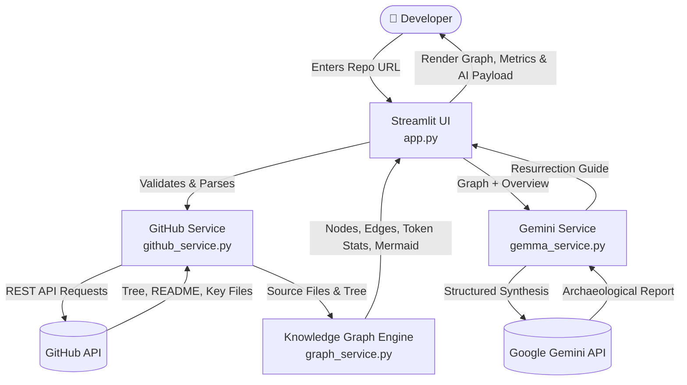

# ⛏️ Digital Archaeologist

> **Excavate Abandoned Codebases & Generate Token-Efficient Knowledge Graphs for AI Agents**

Digital Archaeologist is designed for developers, teams, and students who have returned to a long-abandoned side project or inherited an unfamiliar codebase. Instead of wandering through hundreds of forgotten files or dumping an entire raw codebase into an LLM (which burns tens of thousands of tokens and triggers context rot), Digital Archaeologist constructs a **Codebase Knowledge Graph** that provides full architectural comprehension at a fraction of the token cost.

---

## 🌟 Key Features

- **🏛️ Executive Codebase Summary**: Understand what the abandoned project does, its architecture, and its primary domain in minutes.
- **🗺️ Interactive Module Knowledge Graph**: Generates a structural node-and-edge topological map showing entry points, source modules, and import/dependency relationships.
- **⚡ 90%+ Token Reduction for AI Agents**: Rather than feeding raw source files to AI coding agents (Devin, Cursor, Windsurf, Claude, ChatGPT), export the compact Knowledge Graph payload to preserve context windows.
- **🧭 Project Resurrection Guide**: Identifies key entry points (`main.py`, `app.py`, `index.js`), configuration manifests, and high-priority areas to touch first when dusting off the project.
- **💾 Machine-Readable Export**: Download `knowledge_graph.json` or copy a pre-formatted AI context prompt with a single click.

---

## 🛠️ Tech Stack

| Layer | Technology | Version | Purpose & Rationale |
|---|---|---|---|
| **Frontend / Web UI** | [Streamlit](https://streamlit.io/) | `>= 1.30.0` | Interactive Python web application featuring token economics badges, tabs, and real-time excavation status. |
| **HTTP Client** | [Requests](https://requests.readthedocs.io/) | `>= 2.31.0` | Queries the GitHub REST v3 API for repository metadata, recursive git trees, and source files. |
| **Knowledge Graph Engine** | Python Standard Library (`re`, `json`) | `3.10+` | Deterministic parsing of module imports, declared classes/functions, entry points, and token estimations without heavy dependencies. |
| **AI / LLM Integration** | [Google GenAI SDK](https://github.com/googleapis/python-genai) (`google-genai`) | `>= 0.1.1` | **Gemma Track**: Powered by Gemma 4 (`gemma-4-26b-a4b-it`) for architectural synthesis and resurrection advice. |
| **Configuration** | [python-dotenv](https://github.com/theskumar/python-dotenv) | `>= 1.0.0` | Safely manages `GEMINI_API_KEY` and optional `GITHUB_TOKEN` from `.env`. |

---

## 💎 How Gemma is Harnessed in a Smart Way (Hackathon Track)

Naively feeding raw source code repositories into LLMs wastes context, burns tokens, and causes catastrophic hallucination. Digital Archaeologist implements a **Two-Tier Intelligence Pipeline**:

1. **Deterministic Pre-Compression (Tier 1)**: Python extracts modules, class declarations, function exports, and import dependencies to construct a lightweight topological Knowledge Graph. This eliminates 90%+ of raw noise *before* querying the model.
2. **Gemma Semantic Synthesis (Tier 2)**: Gemma 4 (`gemma-4-26b-a4b-it`) is prompted with the pre-digested Knowledge Graph, README, and entry-point signatures at a disciplined `temperature=0.2`. Gemma operates at peak reasoning fidelity to explain the architecture, identify execution lifecycles, and generate the project resurrection guide.
3. **Resilient Family Fallback**: If a quota or availability threshold is reached, the service automatically cascades across the Gemma family (`gemma-4-26b-a4b-it` → `gemma-4-31b-it` → `gemma-3-27b-it`).

---

## 🏗️ Architecture



---

## 📁 Repository Structure

```text
digital-archaeologist/
├── app.py                  # Streamlit application UI and dashboard
├── graph_service.py        # Module parser, dependency mapper, and Knowledge Graph builder
├── github_service.py       # GitHub REST API client (tree, README, key files)
├── gemma_service.py        # Gemini / Gemma architectural synthesis and prompt builder
├── requirements.txt        # Python package dependencies
├── .env.example            # Environment variable template
├── .gitignore              # Ignored files (.venv, .env, __pycache__)
├── AGENTS.md               # Architecture specifications and contracts
├── IMPLEMENTATION_PLAN.md  # Detailed implementation roadmap
└── README.md               # Project documentation
```

---

## 🚀 Quickstart Guide

### 1. Prerequisites

- Python 3.10 or higher
- A Google Gemini API key ([Get one free from Google AI Studio](https://aistudio.google.com/))

### 2. Setup

```bash
# Clone the repository
git clone https://github.com/samuelmarkmendonca/digital-archaeologist.git
cd digital-archaeologist

# Create and activate virtual environment
python -m venv venv

# Windows (PowerShell):
.\venv\Scripts\Activate.ps1

# Linux / macOS:
source venv/bin/activate

# Install dependencies
pip install -r requirements.txt
```

### 3. Configure API Key

Copy `.env.example` to `.env`:

```bash
cp .env.example .env
```

Set your Gemini API key in `.env`:

```ini
GEMINI_API_KEY="your-gemini-api-key-here"
```

### 4. Run the Application

```bash
streamlit run app.py
```

The app will open at `http://localhost:8501`.

---

## 📊 Why the Knowledge Graph Beats Raw Code Dumps

| Approach | Context Token Usage | Context Decay / Lost in Middle | Cost / Latency |
|---|---|---|---|
| **Raw Codebase Dump** | 30,000 – 120,000+ tokens | 🔴 High (LLM forgets middle files) | 🔴 Expensive & Slow |
| **Digital Archaeologist Knowledge Graph** | **1,500 – 3,500 tokens** | 🟢 Low (Dense, structured map) | 🟢 **Up to 95% Cheaper & Instant** |

---

## 📄 License

This project is licensed under the MIT License.
