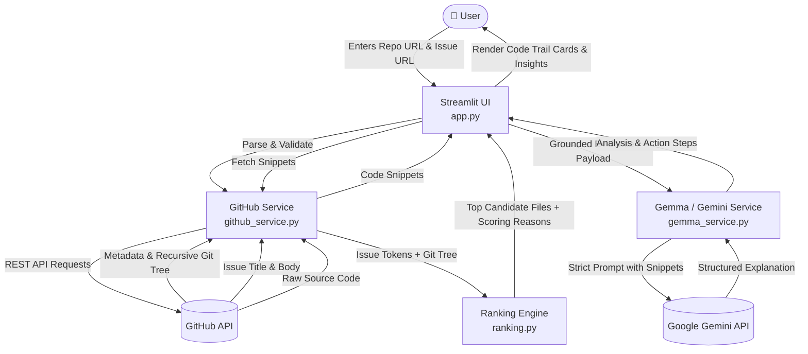

# 🔍 Digital Archaeologist (RepoRescue)

> **AI-Assisted Issue Triaging & Code Trail Investigation for Open-Source Contributors**

Digital Archaeologist (RepoRescue) helps developers and newcomers investigate GitHub issues faster by connecting the dots between issue descriptions and the actual codebase. Instead of wandering aimlessly across hundreds of files or relying on generic AI hallucinations, Digital Archaeologist fetches real repository data, scores files deterministically, extracts relevant code snippets, and leverages Google Gemini / Gemma to generate an evidence-grounded **Code Trail**.

---

## 🌟 Key Features

- **🎯 Deterministic File Candidate Ranking**: Scans the git repository tree and scores file paths using tokenized keyword overlap from the issue title and body. No guesswork.
- **🔗 Real Code Evidence**: Automatically retrieves source code snippets from candidate files directly via the GitHub REST API.
- **🤖 Grounded AI Triage (Gemini / Gemma)**: Synthesizes the issue and real file snippets to provide beginner-friendly explanations, hypothesis checks, and investigation checklists without hallucinating files or lines.
- **⚡ Interactive Streamlit Interface**: Clean, lightweight web interface displaying repository metadata, candidate file cards with direct GitHub links, and actionable next steps.
- **🛡️ Hallucination-Resistant Architecture**: Strict separation of concerns — GitHub provides the facts, Python scores the candidates, and the LLM interprets only what is verified.

---

## 🛠️ Tech Stack

| Layer | Technology | Version | Purpose & Rationale |
|---|---|---|---|
| **Frontend / UI** | [Streamlit](https://streamlit.io/) | `>= 1.30.0` | Rapid, interactive Python web framework. Enables stateful reactive UI without frontend JavaScript overhead. |
| **HTTP & API Client** | [Requests](https://requests.readthedocs.io/) | `>= 2.31.0` | Standard, robust HTTP library for interacting with GitHub REST API v3 (metadata, git trees, raw contents). |
| **AI / LLM Integration** | [Google GenAI SDK](https://github.com/googleapis/python-genai) (`google-genai`) | `>= 0.1.1` | Official Google GenAI Python SDK connecting to Gemini 2.5 / Gemma models for grounded reasoning and explanations. |
| **Config & Secrets** | [python-dotenv](https://github.com/theskumar/python-dotenv) | `>= 1.0.0` | Safely manages sensitive API keys and model configurations from a local `.env` file. |
| **Core Language** | Python | `3.10+` | Type-hinted, modern Python powering deterministic string parsing and ranking logic. |

---

## 🏗️ Architecture



---

## 📁 Repository Structure

```text
digital-archaeologist/
├── app.py                  # Streamlit application UI and workflow coordinator
├── github_service.py       # GitHub REST API client & URL validators
├── ranking.py              # Pure Python keyword tokenization & candidate ranker
├── gemma_service.py        # Google GenAI / Gemma prompt builder & API caller
├── requirements.txt        # Python package dependencies
├── .env.example            # Environment variable template
├── .gitignore              # Files and directories ignored by Git
├── AGENTS.md               # Agent reference documentation and architecture contracts
├── IMPLEMENTATION_PLAN.md  # Detailed step-by-step implementation guide
└── README.md               # Project documentation and user guide
```

---

## 🚀 Quickstart Guide

### 1. Prerequisites

- Python 3.10 or higher installed
- A Google Gemini API key ([Get one from Google AI Studio](https://aistudio.google.com/))
- *(Optional)* A GitHub Personal Access Token if querying heavily or avoiding rate limits (60 requests/hr for unauthenticated calls)

### 2. Clone and Setup Environment

```bash
# Clone the repository
git clone https://github.com/samuelmarkmendonca/digital-archaeologist.git
cd digital-archaeologist

# Create and activate a virtual environment
python -m venv venv

# Windows (PowerShell):
.\venv\Scripts\Activate.ps1

# Linux / macOS:
source venv/bin/activate

# Install dependencies
pip install -r requirements.txt
```

### 3. Configure Environment Variables

Create a `.env` file in the root directory:

```bash
cp .env.example .env
```

Edit `.env` and set your credentials:

```ini
# Required: Google Gemini API Key
GEMINI_API_KEY="your-gemini-api-key-here"

# Optional: Default model (defaults to gemini-2.5-flash or gemma model)
GEMMA_MODEL="gemini-2.5-flash"

# Optional: GitHub token to increase rate limits to 5000 requests/hr
GITHUB_TOKEN=""
```

### 4. Run the Application

```bash
streamlit run app.py
```

The application will open in your default browser at `http://localhost:8501`.

---

## 🖥️ How It Works (Step-by-Step)

1. **Enter Repository URL**: Provide any public GitHub repository (e.g. `https://github.com/psf/requests`).
2. **Enter Issue URL**: Provide an open or closed issue link (e.g. `https://github.com/psf/requests/issues/1234`).
3. **Click "Investigate Issue"**:
   - The app validates the URLs and fetches repository metadata and the Git tree.
   - The ranking module tokenizes the issue and scores file paths based on exact and partial term matches.
   - Source code snippets from the top candidate files are fetched.
   - The prompt is compiled and sent to Gemini/Gemma.
4. **Inspect the Code Trail**:
   - Review candidate file cards with calculated relevancy scores and match reasons.
   - Read the synthesized issue overview and grounded hypotheses.
   - Follow the recommended 3–5 step investigation checklist to start fixing the issue!

---

## ⚠️ Limitations & Ethical Use

- **Public Repositories Only**: Unauthenticated mode works exclusively on public GitHub repositories.
- **Heuristic Ranking**: Path keyword matching is a strong heuristic for finding entry points, but does not perform AST-level code flow or symbol graph traversal.
- **Fact vs Hypothesis**: The AI explanations are strictly derived from the provided snippets. The system highlights what *cannot* be determined without local debugging.

---

## 🔮 Post-MVP Extension: Codebase Knowledge Graph for AI Agents

> **Note**: The core feature and primary mission of Digital Archaeologist is **summarizing the codebase and generating an evidence-based Code Trail for issue investigation**. The knowledge graph generator is a planned post-MVP extension to be implemented once the core MVP is verified and stable.

### Token-Efficient Project Context for Downstream Agents
Passing entire raw files or hundreds of lines of code to AI coding agents quickly exhausts context windows and inflates token costs. To solve this, a post-MVP output option will generate a **Codebase Knowledge Graph**:
- **Compact Structural Topology**: Maps files, exports, and import dependencies into a structured node-and-edge model (`knowledge_graph.json` and interactive Mermaid diagram).
- **Minimal Token Consumption**: Downstream AI agents receive the complete structural context and high-level architectural summary of the repository using up to 80% fewer tokens compared to passing raw files.

---

## 📄 License

This project is licensed under the MIT License.

